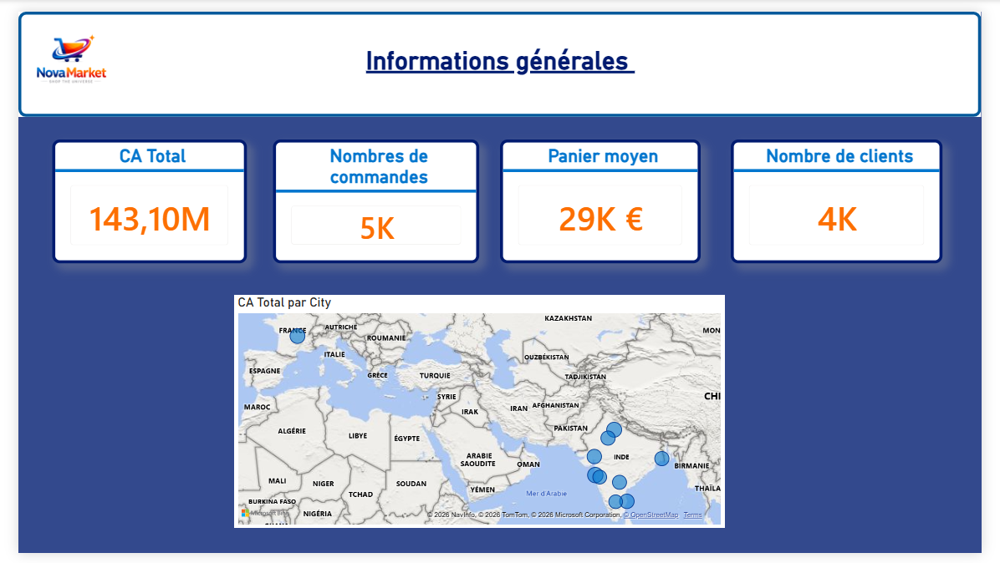

# 📊 NovaMarket – E-commerce Analysis
E-commerce performance and conversion analysis using Power BI

## 🎯 Project Overview

Analysis of NovaMarket's e-commerce performance to identify
conversion opportunities and understand customer behaviour.

## ❓ Business Problem

The objective of this project was to understand:

- Which categories generate the most revenue?
- Which devices convert best?
- Where do users abandon the purchasing funnel?
- Which actions could improve conversion?

## 🛠️ Tools

- Power BI
- Power Query
- DAX

## 📊 Dashboard

)

## 🔎 Key Insights

#### 💰 Revenue concentration across product categories

NovaMarket generated €143.1M in revenue during H1 2026.
The top 3 categories (Books, Apparel and Electronics) accounted for 59% of total revenue (€85M).
The top 3 brands contributed 56% of revenue (€80M), highlighting a concentration risk.

#### 🛒 Purchase journey optimization opportunities

Customers viewed an average of 6.27 pages before purchasing, suggesting potential opportunities to streamline the shopping experience.
Average purchases per session stood at 1.00, indicating opportunities to explore cross-selling and additional purchases.

#### 📱 Balanced purchasing activity across devices

Purchases were almost equally distributed across Tablet (34.1%), Desktop (33.1%) and Mobile (32.8%).
This suggests that UX optimization should address all devices rather than focusing exclusively on mobile.

#### 👥 Limited revenue concentration among top customers

## 💡 Recommendations

#### 🛒 Optimize the customer purchase journey

Analyze friction points across product search, product pages, cart and checkout.
Improve navigation and simplify the purchasing process to support conversion.

#### 📈 Prioritize high-performing product categories

Focus marketing efforts on Books, Apparel and Electronics, which collectively generate 59% of revenue.
Explore growth opportunities in lower-performing categories.

#### 🏷️ Reduce dependency on leading brands

Diversify the product portfolio and strengthen the visibility of private-label products.
Monitor revenue concentration to reduce commercial risks.

#### 💌 Strengthen CRM and customer retention

Develop personalized campaigns based on purchase behaviour and product preferences.
Implement cross-selling and loyalty initiatives to encourage repeat purchases.

#### 📊 Adopt a data-driven optimization approach

Monitor conversion and customer behaviour across all devices.
Improve KPI reliability and extend reporting toward customer segmentation and predictive analytics.

## 📁 Project Files

### Power BI
Power BI dashboard available in the `powerbi` folder.

### Presentation
The complete project presentation is available in PDF and PowerPoint formats.

### Data
Sample dataset used for the analysis.
